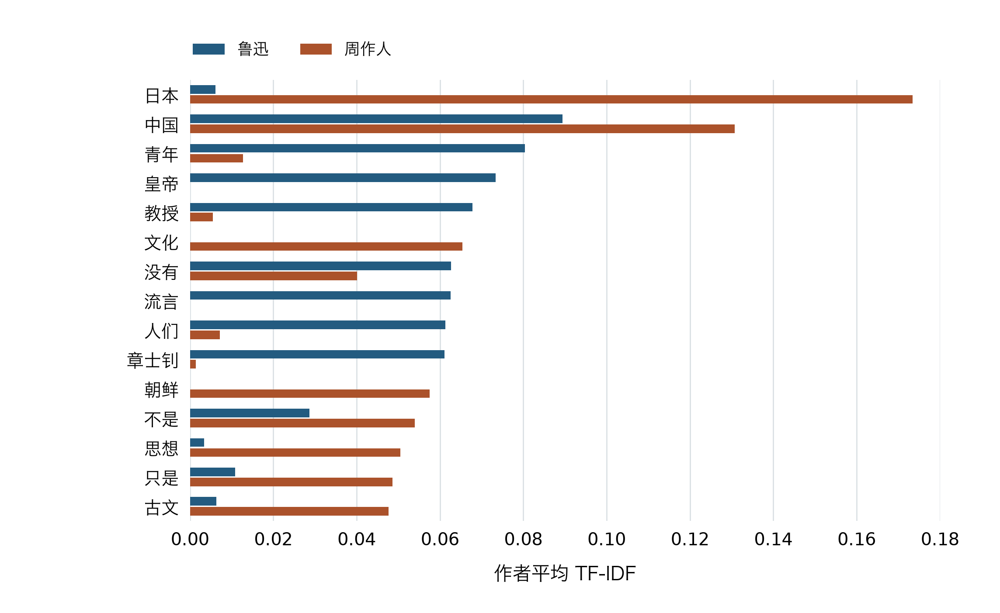
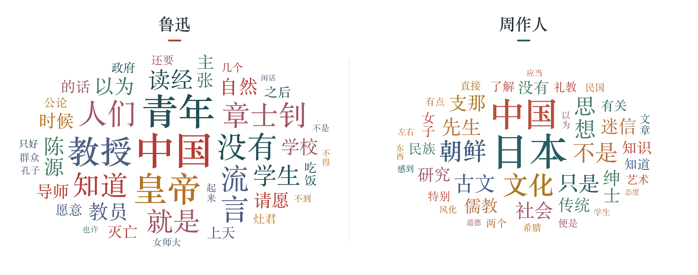

# 鲁迅与周作人杂文的文本特征对比

第4章 文本挖掘与 NLP 任务二

本文比较鲁迅、周作人各15篇白话杂文。鲁迅样本中，“青年”“教授”“流言”关联教育及报刊论争。周作人样本中，“日本”“文化”“思想”提示中日文化讨论和社会观念等议题。对照排名、命中篇数和原文，可看出同一词的不同用法。

## 一 语料与配对

**表1  两位作者的样本范围**

| 作者 | 1925 / 1926 | 篇数 | 单篇字数 | 字数中位数 | 总字数 |
| --- | --- | --- | --- | --- | --- |
| 鲁迅 | 8 / 7 | 15 | 671—2478 | 1022 | 18,502 |
| 周作人 | 8 / 7 | 15 | 727—2334 | 988 | 18,357 |

字数只计正文汉字。附录列出同年配对结果、每篇字数与原文链接。

候选限定为1925—1926年、650—2600字、有明确年代的白话杂文。鲁迅正文取自维基文库，年份参考单篇题头与文末落款。周作人正文取自虚阁网，按文末民国纪年换算。剔除书信、日记、序跋、合刊短章及主要转录或拟对话的篇目，随后在每年按字数差从小到大选取尚未入选的组合。

所用文集 [《华盖集》](<https://zh.wikisource.org/wiki/%E8%8F%AF%E8%93%8B%E9%9B%86>) [《华盖集续编》](<https://zh.wikisource.org/wiki/%E8%8F%AF%E8%93%8B%E9%9B%86%E7%BA%8C%E7%B7%A8>) [《谈虎集》](<https://www.xuges.com/xdmj/zzr/thj/index.htm>)

## 二 分词与计算

统一简体，只取完整正文。去掉页面标题、编者注及独立落款，保留正文内引文。用 jieba 精确模式切分汉字段，关闭 HMM，共用一份专名和时代用语表，保留“章士钊”“顺天时报”等完整词项。

手工停用词表按代词、连接词、指示词、通用时间及语气表达编制，共149项，分析前固定。按整词匹配去掉“我们”“因此”等，同时去掉单字和纯数词。完整[分词规则](./复现材料/分词规则.json)、[逐篇分词与权重](./复现材料/结果.json)和[选篇记录](./复现材料/选篇记录.json)随附。

用 scikit-learn 的 TfidfVectorizer 在30篇上共同拟合，参数为一元词项、min_df=2、max_df=0.90、原始词频、平滑 IDF 与 L2 归一化。每位作者对15篇取算术平均，未命中的篇目按0计。用计数和公式独立复核词表、作者均值及命中篇数。

工具说明 [jieba](<https://github.com/fxsjy/jieba>) [TfidfVectorizer](<https://scikit-learn.org/stable/modules/generated/sklearn.feature_extraction.text.TfidfVectorizer.html>)

## 三 高权重词与条形对照

30篇共保留1,039个词项。表2列出两位作者各自的前十项。篇数用于区分反复出现的词与集中在少数文章中的词。

**表2  按作者平均 TF-IDF 排名前十的词**

| 名次 | 鲁迅 | 均值（篇数） | 周作人 | 均值（篇数） |
| --- | --- | --- | --- | --- |
| 1 | 中国 | 0.0894（14） | 日本 | 0.1734（6） |
| 2 | 青年 | 0.0804（8） | 中国 | 0.1307（12） |
| 3 | 皇帝 | 0.0733（3） | 文化 | 0.0654（6） |
| 4 | 教授 | 0.0678（6） | 朝鲜 | 0.0575（2） |
| 5 | 没有 | 0.0627（13） | 不是 | 0.0539（15） |
| 6 | 流言 | 0.0625（6） | 思想 | 0.0505（8） |
| 7 | 人们 | 0.0613（7） | 只是 | 0.0486（12） |
| 8 | 章士钊 | 0.0611（6） | 古文 | 0.0477（1） |
| 9 | 知道 | 0.0598（12） | 先生 | 0.0473（4） |
| 10 | 就是 | 0.0590（13） | 社会 | 0.0451（9） |

**图1  两组高权重词的条形对照**

绘制任一作者进入前八的词，并在同一横轴上对照两组均值。

## 四 词云与主题线索

**图2  两位作者各自的高权重词云**

每幅取本组前42项。字号随组内权重与排名缩放，跨组比较请看图1。

**表3  原文支持的议题线索**

| 作者 | 议题线索 | 词项及命中篇数 |
| --- | --- | --- |
| 鲁迅 | 教育与公共论争 | 青年（8）、教授（6）、学生（7）、流言（6） |
| 鲁迅 | 政治讽议 | 皇帝（3）、章士钊（6） |
| 周作人 | 中日文化与报刊论争 | 日本（6）、中国（12）、文化（6） |
| 周作人 | 礼教与社会观念 | 思想（8）、礼教（5）、社会（9） |

主题由回读原文归纳。篇数指词项在该作者全部样本中的命中数。

## 五 词项在篇目中的分布

用权重最高的单篇除以该作者各篇的权重总和，检查高分是否集中在一篇。对同一词另列两年的均值，两年沿用全样本共同拟合的 IDF。

**表4  部分词项的年份分布与最高单篇占比**

| 作者 | 词项 | 1925年均值 | 1926年均值 | 最高单篇占比 |
| --- | --- | --- | --- | --- |
| 鲁迅 | 青年 | 0.0679 | 0.0947 | 37% |
| 鲁迅 | 皇帝 | 0.0089 | 0.1470 | 59% |
| 周作人 | 日本 | 0.1688 | 0.1787 | 28% |
| 周作人 | 朝鲜 | 0.0000 | 0.1233 | 91% |

“朝鲜”的权重约91%来自《李完用与朴烈》。相比之下，“日本”在两年都有较高均值，其主要语境仍需结合具体篇目。

## 六 原文抽查

每条列出词项、篇名、正文段号和短摘。篇号链接到全文。段号与随附语料一致。

**表5  高权重词与原文语境**

| 词项 | 篇目与原文短摘 | 语境 |
| --- | --- | --- |
| 青年 | [L03](<https://zh.wikisource.org/wiki/%E5%B0%8E%E5%B8%AB>)  导师  §1 “但青年又何能一概而论” | 区分不同处境的青年，后文建议寻找同伴。 |
| 青年 | [L14](<https://zh.wikisource.org/wiki/%E3%80%8C%E6%AD%BB%E5%9C%B0%E3%80%8D>)  「死地」  §10 “觉悟的青年应该不肯轻死” | 惨案后的劝诫，着眼青年如何行动。 |
| 教授 | [L07](<https://zh.wikisource.org/wiki/%E6%88%91%E8%A7%80%E5%8C%97%E5%A4%A7>)  我观北大  §6 “教授和学生也都逐年地有些改换了” | 讨论北大人员更替与办学精神的延续。 |
| 流言 | [L15](<https://zh.wikisource.org/wiki/%E5%8F%AF%E6%85%98%E8%88%87%E5%8F%AF%E7%AC%91>)  可惨与可笑  §1 “在于「流言」的奏了功效” | 作者把流言与三一八惨案联系起来。 |
| 读经 | [L06](<https://zh.wikisource.org/wiki/%E5%8D%81%E5%9B%9B%E5%B9%B4%E7%9A%84%E3%80%8C%E8%AE%80%E7%B6%93%E3%80%8D>)  十四年的「读经」  §1 “章士钊主张读经以来” | 从章士钊提倡读经写起，追问主张者的用意。 |
| 读经 | [Z02](<https://www.xuges.com/xdmj/zzr/thj/040.htm>)  读经之将来  §2 “关于读经之将来这问题” | 模拟占卜预言，讽刺尊孔读经风潮。 |
| 日本 | [Z04](<https://www.xuges.com/xdmj/zzr/thj/116.htm>)  日本与中国  §1 “有了解日本的必要与可能” | 把了解日本文化作为研究问题提出。 |
| 日本 | [Z06](<https://www.xuges.com/xdmj/zzr/thj/117.htm>)  日本浪人与顺天时报  §3 “我决不怪日本报纸发表什么暴论” | 比较日本国内报纸和在华汉字报纸的角色。 |
| 文化 | [Z09](<https://www.xuges.com/xdmj/zzr/thj/105.htm>)  论做鸡蛋糕  §7 “文化道德的发达变迁” | 在讨论女子教育时，提出人类学知识的价值。 |
| 朝鲜 | [Z11](<https://www.xuges.com/xdmj/zzr/thj/128.htm>)  李完用与朴烈  §13 “对于朝鲜为日本所陵践” | 作者评述朝鲜受日本吞并后的处境。 |
| 礼教 | [Z08](<https://www.xuges.com/xdmj/zzr/thj/089.htm>)  萨满教的礼教思想  §7 “中国据说以礼教立国” | 从礼教的说法切入，批评以维持风化为名的做法。 |

## 七 结果解释

在这30篇杂文中，鲁迅样本的“青年”见于8篇，“教授”和“流言”各见于6篇。《导师》谈青年如何寻找同伴，《可惨与可笑》把流言与三一八惨案联系起来。周作人样本的“日本”在两年均有较高权重。《日本与中国》讨论研究日本文化的价值，《日本浪人与顺天时报》则把注意力转向在华汉字报刊。“文化”还出现在《论做鸡蛋糕》关于女子教育的讨论中。

同样谈到“读经”，鲁迅追问提倡者的用意，周作人借占卜预言的口吻讽刺读经风潮。同一个关键词可以用来展开不同的论述，判断其用法需要回到原文。

高权重也可能来自单篇集中使用。例如周作人样本中，“朝鲜”的权重约91%来自《李完用与朴烈》。本次配对控制了年份和篇幅，两组的议题构成仍有差别。因此，结果可以描述这批文章的用词分布与论述重心，无法据此判断两位作者的整体文风或政治立场。

## 附录  三十篇样本与来源

同一行是同年内的一组篇幅配对。点击篇名查原文。配对只控制写作或发表年份及正文长度。

| 年份 | 鲁迅 | 字数 | 周作人 | 字数 | 相差 |
| --- | --- | --- | --- | --- | --- |
| 1925 | [L01  论辩的魂灵](<https://zh.wikisource.org/wiki/%E8%AB%96%E8%BE%AF%E7%9A%84%E9%AD%82%E9%9D%88>) | 828 | [Z01  古文秘诀](<https://www.xuges.com/xdmj/zzr/thj/081.htm>) | 808 | 20 |
| 1925 | [L02  杂感](<https://zh.wikisource.org/wiki/%E9%9B%9C%E6%84%9F_(%E9%AD%AF%E8%BF%85)>) | 903 | [Z02  读经之将来](<https://www.xuges.com/xdmj/zzr/thj/040.htm>) | 897 | 6 |
| 1925 | [L03  导师](<https://zh.wikisource.org/wiki/%E5%B0%8E%E5%B8%AB>) | 671 | [Z03  风纪之柔脆](<https://www.xuges.com/xdmj/zzr/thj/088.htm>) | 938 | 267 |
| 1925 | [L04  「碰壁」之后](<https://zh.wikisource.org/wiki/%E3%80%8C%E7%A2%B0%E5%A3%81%E3%80%8D%E4%B9%8B%E5%BE%8C>) | 2478 | [Z04  日本与中国](<https://www.xuges.com/xdmj/zzr/thj/116.htm>) | 2334 | 144 |
| 1925 | [L05  并非闲话 (二)](<https://zh.wikisource.org/wiki/%E4%B8%A6%E9%9D%9E%E9%96%92%E8%A9%B1_(%E4%BA%8C)>) | 1233 | [Z05  孙中山先生](<https://www.xuges.com/xdmj/zzr/thj/072.htm>) | 1260 | 27 |
| 1925 | [L06  十四年的「读经」](<https://zh.wikisource.org/wiki/%E5%8D%81%E5%9B%9B%E5%B9%B4%E7%9A%84%E3%80%8C%E8%AE%80%E7%B6%93%E3%80%8D>) | 1781 | [Z06  日本浪人与顺天时报](<https://www.xuges.com/xdmj/zzr/thj/117.htm>) | 1730 | 51 |
| 1925 | [L07  我观北大](<https://zh.wikisource.org/wiki/%E6%88%91%E8%A7%80%E5%8C%97%E5%A4%A7>) | 758 | [Z07  道学艺术家的两派](<https://www.xuges.com/xdmj/zzr/thj/087.htm>) | 856 | 98 |
| 1925 | [L08  这回是「多数」的把戏](<https://zh.wikisource.org/wiki/%E9%80%99%E5%9B%9E%E6%98%AF%E3%80%8C%E5%A4%9A%E6%95%B8%E3%80%8D%E7%9A%84%E6%8A%8A%E6%88%B2>) | 1233 | [Z08  萨满教的礼教思想](<https://www.xuges.com/xdmj/zzr/thj/089.htm>) | 988 | 245 |
| 1926 | [L09  学界的三魂](<https://zh.wikisource.org/wiki/%E5%AD%B8%E7%95%8C%E7%9A%84%E4%B8%89%E9%AD%82>) | 2179 | [Z09  论做鸡蛋糕](<https://www.xuges.com/xdmj/zzr/thj/105.htm>) | 2129 | 50 |
| 1926 | [L10  我还不能「带住」](<https://zh.wikisource.org/wiki/%E6%88%91%E9%82%84%E4%B8%8D%E8%83%BD%E3%80%8C%E5%B8%B6%E4%BD%8F%E3%80%8D>) | 1374 | [Z10  支那与倭](<https://www.xuges.com/xdmj/zzr/thj/127.htm>) | 1360 | 14 |
| 1926 | [L11  送灶日漫笔](<https://zh.wikisource.org/wiki/%E9%80%81%E7%81%B6%E6%97%A5%E6%BC%AB%E7%AD%86>) | 1517 | [Z11  李完用与朴烈](<https://www.xuges.com/xdmj/zzr/thj/128.htm>) | 1664 | 147 |
| 1926 | [L12  谈皇帝](<https://zh.wikisource.org/wiki/%E8%AB%87%E7%9A%87%E5%B8%9D>) | 816 | [Z12  两个鬼](<https://www.xuges.com/xdmj/zzr/thj/101.htm>) | 784 | 32 |
| 1926 | [L13  无花的蔷薇之二](<https://zh.wikisource.org/wiki/%E7%84%A1%E8%8A%B1%E7%9A%84%E8%96%94%E8%96%87%E4%B9%8B%E4%BA%8C>) | 1022 | [Z13  清浦子爵之特殊理解](<https://www.xuges.com/xdmj/zzr/thj/125.htm>) | 1000 | 22 |
| 1926 | [L14  「死地」](<https://zh.wikisource.org/wiki/%E3%80%8C%E6%AD%BB%E5%9C%B0%E3%80%8D>) | 835 | [Z14  支那民族性](<https://www.xuges.com/xdmj/zzr/thj/126.htm>) | 727 | 108 |
| 1926 | [L15  可惨与可笑](<https://zh.wikisource.org/wiki/%E5%8F%AF%E6%85%98%E8%88%87%E5%8F%AF%E7%AC%91>) | 874 | [Z15  女子学院的火](<https://www.xuges.com/xdmj/zzr/thj/061.htm>) | 882 | 8 |

《谈虎集》的版本信息见[1928年北新书局本书目](<https://ci.nii.ac.jp/ncid/BA57968621>)。配对优先控制时间和篇幅，两组的议题构成仍有差别。
